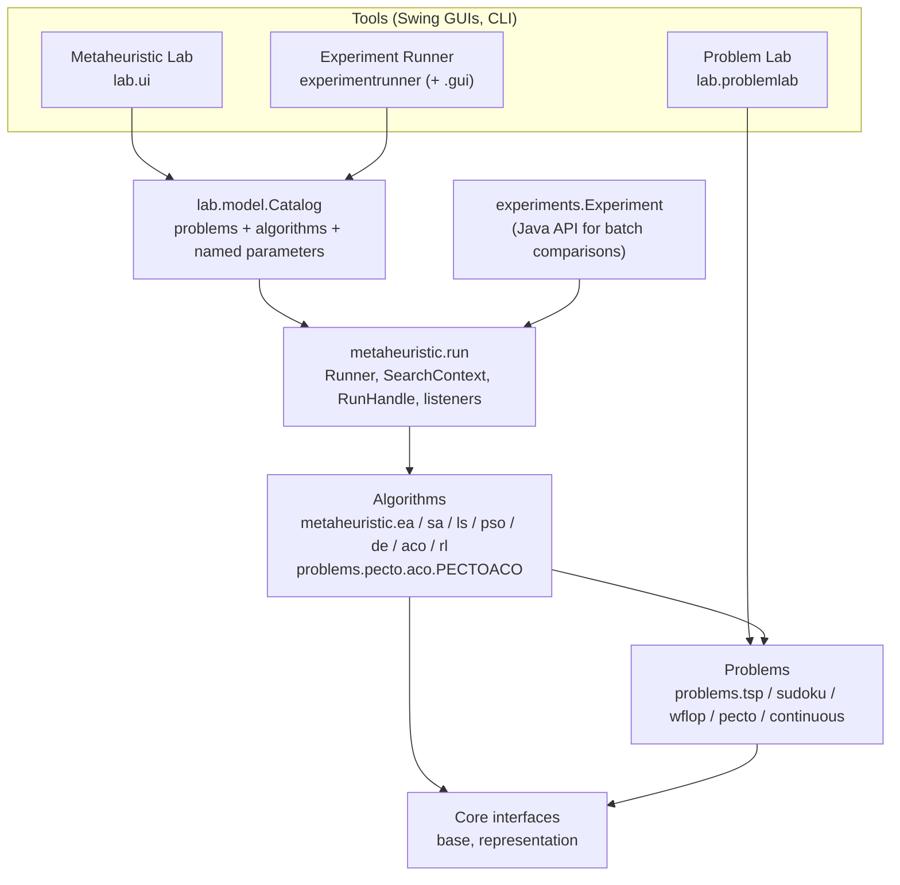
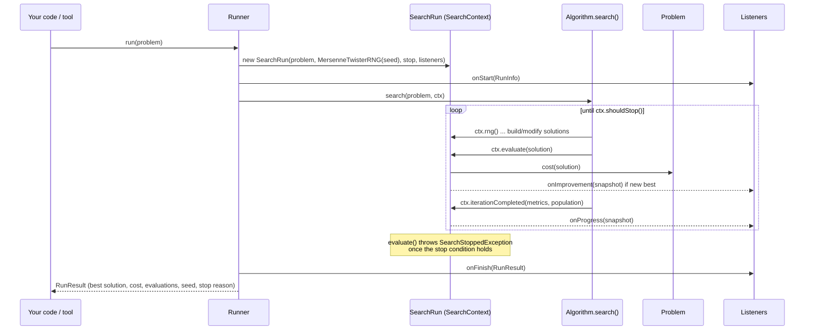

# 1. Architecture

This document explains how the code is organized and how one run of an algorithm works, from the moment you call
`Runner.run` until a `RunResult` comes back. Most of the project follows a few rules (section 4). Once you know them,
most classes are easy to read.

## 1.1 The big picture



Read the diagram from the bottom up:

- **Core interfaces** (`base`, `representation`) define what a solution, a problem and an operator are.
- **Problems** implement `OptimizationProblem<S>` for their own solution type `S`.
- **Algorithms** implement `Metaheuristic<S, P>`. They are generic, so most of them (EA, SA, local search) work on any
  problem that supplies operators. Some are written for one problem only; `PECTOACO` is one of these.
- **`metaheuristic.run`** runs an algorithm on a problem. It owns the RNG, counts evaluations, tracks the best
  solution, enforces the budget and informs listeners.
- **`lab.model.Catalog`** lists the problems and algorithms that the tools offer, with named, typed parameters. The
  **Metaheuristic Lab** and the **Experiment Runner** are both built on it. A problem or algorithm that is not in the
  catalog cannot be run from either tool.
- **`experiments.Experiment`** is a small Java API for running a set of algorithm/problem cases several times in
  parallel. It does not use the catalog.

## 1.2 Package map

All sources are in `src/main/java`. The packages you need for PECTO work are in **bold**.

| Package | Contents |
|---|---|
| **`base`** | `OptimizationProblem<S>`, `MutationOperator<S>`, `InitialSolutionGenerator<S>`, `ContinuousProblem` |
| **`representation`**, `representation.base` | `Representation<S>`, `Individual<S>`, `Population`; generic encodings (`IntegerPermutation`, `IntegerVector`, `DoubleVector`, `BinaryString`, ...) |
| **`metaheuristic`** | `Metaheuristic<S,P>`, `AbstractMetaheuristic`, `Params` (parameter validation for builders) |
| **`metaheuristic.run`** | `Runner`, `SearchContext`, `SearchRun` (the live run), `RunHandle`, `RunResult`, `Progress`/`ProgressSnapshot`, `Metrics`, `SearchListener`, `StopReason` |
| **`metaheuristic.termination`** | Stop conditions: evaluations, iterations, time, target cost, stagnation, and/or combinations |
| `metaheuristic.listener` | Console and CSV listeners, `Listeners.throttled(...)`, `Listeners.async(...)` |
| `metaheuristic.ea` (+ subpackages) | Evolutionary algorithm with pluggable selection, crossover, mutation, replacement and per-generation hooks |
| `metaheuristic.sa`, `metaheuristic.ls` | Simulated annealing, local search |
| `metaheuristic.pso`, `metaheuristic.de` | Particle swarm, differential evolution (continuous problems only) |
| `metaheuristic.aco` | Generic Ant System for `GraphProblem`s (TSP, and PECTO as a giant tour) |
| `metaheuristic.rl` | Deep Q-learning as a constructive metaheuristic (wind farm problem) |
| `operators` | Generic mutation operators for arrays and permutations |
| **`problems.pecto`** | The PECTO model: `PECTOProblem`, `PECTOSolution`, `Route`, `Urgency`, instances, files, `PECTOGraph` |
| **`problems.pecto.operators`** | Generators and operators for PECTO, `OptimalHospitals` |
| **`problems.pecto.aco`** | `PECTOACO` and its parts: `CandidateLists`, `Pheromone`, `Ant`, `AntBuilds` |
| `problems.tsp`, `problems.sudoku`, `problems.wflop`, `problems.continuous` | Other problems |
| **`experiments`** | `Experiment`, `ExperimentCase`, result handlers (`ConsoleERH`, `CsvERH`) |
| **`experimentrunner`**, `experimentrunner.gui` | Persistent experiment queue, background worker, CLI, window, tray icon |
| **`lab`, `lab.model`, `lab.ui`, `lab.view`** | Metaheuristic Lab: `Catalog`, parameter model, main window, solution visualizers (`PECTOVisualizer`) |
| `lab.problemlab` (+ `model`, `ui`, `pecto`) | Problem Lab: interactive instance and solution editor; `lab.problemlab.pecto` is the PECTO editor |
| `util.random` | `RNG`, `MersenneTwisterRNG`, `Seeds` |
| `examples` | Runnable demos (TSP, continuous, Sudoku, WFLOP, monitoring) |

Tests are in `src/test/java`, in the same packages as the classes they test.

Other folders at the project root:

| Folder | Contents |
|---|---|
| `experiments/` | The experiment runner's workspace (see [Experiments](03-experiments.md)). Journals, specs and results are committed. |
| `research/` | Old code kept for reference (an earlier ACO implementation). Not compiled. |
| `results/` | Scratch output of examples. Ignored by git. |
| `notes/` | Loose notes. |
| `doc/` | This documentation. |

## 1.3 Core interfaces

### Solutions: `Representation<S>`

```java
public interface Representation<S extends Representation<S>> {
    S copy();
    default double distanceTo(S other) { throw new UnsupportedOperationException(...); }
}
```

`S` is the implementing class itself (`PECTOSolution implements Representation<PECTOSolution>`). This "self type"
makes the whole toolkit type-safe. For example, passing a TSP instance to PSO is a compile error.

Rules:

- `equals`/`hashCode` are **value-based**. The run uses them to detect duplicate solutions in a population.
- A solution is **never modified** once an algorithm has it. Operators return new objects. Immutable classes such as
  `PECTOSolution` simply return `this` from `copy()`.
- `distanceTo` is optional. When it is defined, the run can report a population's `diversity` (section 1.6).

### Problems: `OptimizationProblem<S>`

```java
public interface OptimizationProblem<S extends Representation<S>> {
    double cost(S solution);                       // always minimized
    default boolean isFeasible(S solution) { return true; }
}
```

A problem must be **immutable and thread-safe**, because many runs share one instance at the same time. Problem data
such as coordinates and capacities is fixed when the problem is constructed.

### Operators and generators

```java
@FunctionalInterface
public interface MutationOperator<S> {               // a neighbor of the solution
    S apply(S solution, RNG rng);
}

@FunctionalInterface
public interface InitialSolutionGenerator<S> {       // a starting solution
    S generate(OptimizationProblem<S> problem, RNG rng);
}

public interface CrossOverOperator<S> {              // metaheuristic.ea.base
    List<S> apply(S p1, S p2, RNG rng);
}
```

Operators **must not modify their inputs** and **must keep no mutable state**. They receive the RNG as a parameter
and never create their own. The test suite checks the first rule for every operator.

### Algorithms: `Metaheuristic<S, P>`

```java
public interface Metaheuristic<S extends Representation<S>, P extends OptimizationProblem<S>> {
    void search(P problem, SearchContext<S> ctx);   // searches until ctx.shouldStop() or it finishes
    String getName();
    default String describe() { return getName(); } // name + parameters, recorded with every run
}
```

Algorithms extend `AbstractMetaheuristic`, which builds `describe()` from `parameters()`. They are created through a
**builder** that validates every parameter with the helpers in `Params` (`Params.positive`, `Params.probability`, ...).
`PECTOACO.builder()...build()` is a typical example.

## 1.4 How a run works

```java
RunResult<PECTOSolution> result = Runner.of(PECTOACO.builder().build())
        .seed(42)                                     // same seed => identical run
        .stopWhen(new EvaluationBasedTC(72_601))      // exact budget
        .diagnostics(true)                            // add stagnation / diversity / duplicates metrics
        .listener(Listeners.throttled(Listeners.console(), 1000))
        .run(PECTOInstances.paper(1, 42));
```



What `SearchContext` gives the algorithm:

| Method | Purpose |
|---|---|
| `rng()` | The run's own seeded RNG. **The only allowed source of randomness.** |
| `evaluate(s)` | Computes the cost, counts the evaluation, records a new best solution (as a copy), notifies listeners. Throws `SearchStoppedException` if the budget is already used up. The runner catches that exception, so an algorithm can never go over budget. |
| `shouldStop()` | True once the stop condition holds or the run was cancelled. Algorithms check it in their loops. |
| `iterationCompleted(metrics, population)` | Ends an iteration. It publishes progress with algorithm-specific metrics (e.g. `temperature`, `meanCost`, `branchingFactor`). Population-based algorithms also pass the population, from which diversity is measured. |
| `progress()`, `bestSolution()` | The current state. |

The typical shape of an algorithm, from `LocalSearch`:

```java
public void search(OptimizationProblem<S> problem, SearchContext<S> ctx) {
    RNG rng = ctx.rng();
    S current = generator.generate(problem, rng);
    double currentCost = ctx.evaluate(current);
    while (!ctx.shouldStop()) {
        S neighbor = operators.get(rng.randInt(operators.size())).apply(current, rng);
        double neighborCost = ctx.evaluate(neighbor);
        if (neighborCost < currentCost) { current = neighbor; currentCost = neighborCost; }
        ctx.iterationCompleted(Metrics.of(Metrics.CURRENT_COST, currentCost));
    }
}
```

The best solution is tracked by the context, not by the algorithm. A run's result is therefore always the best
solution that was **evaluated**, whatever the algorithm does with it afterwards.

### Running in the background: `RunHandle`

`Runner.start(problem, executor)` runs on an executor and returns a thread-safe `RunHandle` with `latestProgress()`,
`cancel()` and `result()` (a `CompletableFuture`). The Metaheuristic Lab and the experiment runner's worker both use
it. A cancelled run ends at its next `shouldStop()`/`evaluate()` with `StopReason.CANCELLED`.

### Stop conditions

`metaheuristic.termination` contains `EvaluationBasedTC`, `IterationBasedTC`, `TimeBasedTC`, `CostBasedTC` (target
cost) and `StagnationTC`. They are combined with `TerminalCondition.anyOf(...)` / `allOf(...)` or `a.or(b)`. A stop
condition is a **stateless function of `Progress`**, so one instance can serve many runs.

Use **evaluation budgets** for comparisons. They are exact and do not depend on the machine's load. Time budgets
change with the machine and with how many runs share it.

## 1.5 Reproducibility

Every run is fully determined by **(algorithm description, problem instance, seed, stop condition)**. There is no
global randomness anywhere in the code.

- `Runner.seed(s)` creates a `MersenneTwisterRNG(s)` for the run. Without a seed, a random one is chosen and recorded
  in the `RunInfo`/`RunResult`, so the run can still be repeated.
- `util.random.Seeds.derive(base, keys...)` mixes a base seed with keys (SplitMix64). Every tool uses it to give each
  run its own seed, independent of thread scheduling:
  - `Experiment`: `Seeds.derive(base, caseIndex, repeat)`
  - experiment runner: `Seeds.derive(seeds.base, instance.seedKey, repeat)`. Every configuration gets the same seed
    for the same instance and repeat (common random numbers).
  - Metaheuristic Lab: run *i* of the list gets `Seeds.derive(baseSeed, i)`
- Algorithms that use threads internally must stay deterministic. `PECTOACO` gives every ant its own RNG, derived
  from the run's, so its sequential and parallel modes produce exactly the same run (see
  [PECTOACO, section 5.9](05-pecto-aco.md#59-execution-modes-and-performance)).
- Problem instances are generated from their own seed (`instance seed` in the catalog), separate from the run seed.

**Golden-master tests** (e.g. `PECTOACOGoldenTest`) record fingerprints of fixed runs. If a refactoring or a speed-up
changes them, it has changed the search. Experiments rely on this to stay comparable across code versions.

## 1.6 Monitoring and metrics

- `SearchListener` has `onStart`, `onProgress` (every iteration), `onImprovement` (new best) and `onFinish`. Callbacks
  run **on the search thread**, so they must be fast. Wrap slow ones with `Listeners.async(...)` or
  `Listeners.throttled(...)`.
- Each iteration's metrics are a `Map<String, Double>`. The standard keys are in `Metrics`: `currentCost`, `meanCost`.
- With `Runner.diagnostics(true)` (always on in the lab and in the experiment runner), the run adds:
  - `stagnation`: iterations since the best solution last improved;
  - `duplicates`: share of the reported population that equals an earlier member;
  - `diversity`: mean `distanceTo` between members, from a sample of at most 16. It is only reported if the
    representation defines a distance. For PECTO it is the share of patients whose predecessor or hospital differs
    between two solutions (see [PECTO, section 4.3](04-pecto-problem.md#distance-between-solutions)).
- Diagnostics never change the search: they use no randomness and do not touch the algorithm's state.

## 1.7 The catalog: one description for the GUI and the experiment runner

`lab.model.Catalog.problems()` returns a list of `LabProblem`s. Each one has:

- a **name** (e.g. `"Casualty transport (PECTO)"`);
- problem **parameters** as `ParamSpec`s (`integer`, `real`, `choice`), with default, range and description;
- the **algorithms** that can solve it, each an `AlgorithmSpec` with its own `ParamSpec`s and a factory
  `(problem, ParamValues) -> Metaheuristic`. EA, SA and Local Search get their ingredients from the problem's entry as
  `Options`: named alternatives for the **initial solutions** and the **mutation operators**, the first being the
  default. Each becomes a choice parameter of the algorithm (`initial solutions`, `mutation operators`), shown even
  when a problem has a single alternative, so that the lab always tells what a run starts from;
- optionally a **visualizer** (`SolutionVisualizer`) that draws a solution.

`ProblemSpec<S, P>` keeps the generic types inside, so the UI only sees names and values. `MultiEncodingProblem`
offers one problem through several encodings. PECTO has two: *routes* (`PECTOSolution`, for EA, SA, local search and
`ACO (MMAS)` = PECTOACO) and *giant tour* (`IntegerPermutation` over `PECTOGraph`, for the generic `ACO`).

**Why this matters:** the experiment runner's spec files name problems, algorithms and parameters **by their catalog
names**: `"algorithm": "ACO (MMAS)"`, `"explorer rate": 0.05`. When you add a parameter to `PECTOACO.Builder`, you
must also add it to `Catalog.pectoAco()`. Otherwise neither the lab nor experiments can set it.

## 1.8 Extending the code

**A new algorithm for an existing problem**

1. Write a class extending `AbstractMetaheuristic<S, P>`, with a `Builder` that validates parameters with `Params`.
2. Keep all run state in local variables of `search()` (or in helper objects created there), never in fields.
3. Use only `ctx.rng()`, evaluate only through `ctx.evaluate`, check `ctx.shouldStop()`, call
   `ctx.iterationCompleted(...)` once per iteration with useful metrics.
4. Add an `AlgorithmSpec` to the problem's entry in `Catalog`.
5. Add tests: same seed gives the same run, the budget is respected, solutions are feasible.

**A new problem**

1. A representation (immutable, value-based `equals`/`hashCode`, optionally `distanceTo`).
2. A problem class implementing `OptimizationProblem<S>` (immutable).
3. Generators and operators that do not modify their inputs.
4. A `ProblemSpec` in `Catalog` (and optionally a `SolutionVisualizer`).
5. Optionally a `ProblemWorkbench` for the Problem Lab (see its
   [developer guide](../src/main/java/lab/problemlab/doc/Problem-Lab-Developer-Guide.md)).

## 1.9 Tests

`./mvnw test` runs everything. The suite checks, among other things:

- reproducibility (same seed, same run) and concurrency (results independent of thread count);
- exact budgets and cancellation;
- operator contracts (inputs are not modified) and feasibility preservation;
- PECTO: cost equations, file round trips, `OptimalHospitals` against brute force, operators, the PECTO editor;
- PECTOACO: behavior tests (`PECTOACOTest`) and the bit-for-bit golden master (`PECTOACOGoldenTest`);
- experiment runner: spec validation, summaries and statistics, the worker, cleanup.

`PECTOACOBenchmark` (in the test sources, not a JUnit test) measures PECTOACO's wall time on a Table I instance. Use
it to compare two builds of the same search.

## 1.10 Build pitfalls

- **Java 21+** is required (records, switch expressions, text blocks are used).
- **Spurious `Unresolved compilation problem` errors.** The VS Code Java extension (Eclipse JDT) can write broken
  classes into `target/classes` when a source does not compile in its view, overwriting Maven's output. Symptoms: a
  run fails with `java.lang.Error: Unresolved compilation problem`, or the experiment runner refuses to start the
  worker. Fix: `./mvnw clean compile`. The worker checks for such classes before freezing a runtime (see
  [Experiments](03-experiments.md#36-the-worker-and-frozen-runtimes)).
- `./mvnw compile exec:java` runs **inside Maven's JVM**. That is fine for the labs and the examples. Start the
  experiment runner's CLI from the IDE or with plain `java` instead (see [Tools](02-tools.md#25-experiment-runner-cli-and-window)).
