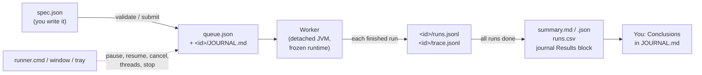

# 3. Experiments

There are three ways to run algorithms. They differ in how much they record and how long they can run:

| | Metaheuristic Lab | `experiments.Experiment` (Java API) | Experiment runner |
|---|---|---|---|
| Purpose | Look and explore | Small scripted comparisons, tests, examples | Planned studies whose results you will report or act on |
| Defined in | The GUI | Java code | A JSON spec, by catalog names |
| Runs in | The GUI's JVM | Your program's JVM | A detached background worker process |
| Survives closing / reboot | No | No | Yes: it resumes where it stopped |
| Records | CSV export of curves | What your handlers write | `runs.jsonl`, `trace.jsonl`, summary with statistics, journal |
| Seeds | `derive(base, i)` | `derive(base, case, repeat)` | `derive(base, seedKey, repeat)`, the same for all configurations |

**Every result used in a paper, a thesis or a design decision should come from the experiment runner**, with a
journal written before the runs started.

## 3.1 The Java API: `experiments.Experiment`

```java
PECTOProblem problem = PECTOInstances.random(20, 400, 8, 60, 7);
Experiment.of(
        ExperimentCase.of("plain", PECTOACO.builder().explorers(0).build(), problem),
        ExperimentCase.of("explorers", PECTOACO.builder().build(), problem))
    .repeats(10).seed(42).threads(8)
    .stopWhen(new EvaluationBasedTC(20_000))
    .handler(new ConsoleERH())                                  // best / mean / std per case
    .handler(new CsvERH(Paths.get("results", "pecto.csv")))    // one row per run, with seed and parameters
    .listenerPerRun(info -> new CsvProgressListener(Paths.get("results", info.seed() + ".csv")))
    .run();
```

- Repeat *r* of case *c* uses `Seeds.derive(seed, c, r)`, so the results do not depend on the number of threads.
  Note that **different cases get different seeds** here. The experiment runner instead pairs the configurations
  on the same seeds.
- Result handlers (`ExperimentResultHandler`) receive all repeats of a case, in case order, on the calling thread.
- Everything is lost if the JVM ends. Use this API for anything that takes minutes, not hours.

## 3.2 The experiment runner: concepts



- An **experiment** is a set of runs: every **configuration** (algorithm parameter settings) on every **instance**
  (problem parameter settings), for a number of **repeats**.
- A **run** is identified by `(configuration, instance, repeat)` and is deterministic. Its seed is
  `Seeds.derive(seeds.base, instance.seedKey, repeat)`, **the same in every configuration**. Configurations are
  therefore compared on the same random numbers (common random numbers), which makes paired comparisons much more
  sensitive.
- Runs are **atomic**. A run that is interrupted (pause now, stop now, crash, reboot) is not checkpointed. It simply
  runs again from the start, and gives the same result because it is deterministic.
- The **worker** is the only process that runs experiments. Everything else (CLI, window, tray) only edits
  `queue.json` under a file lock, and the worker reads it about twice a second.

## 3.3 Writing a spec

A spec names the problem, the algorithm and every parameter **exactly as the catalog does** (the names you see in the
Metaheuristic Lab's parameter tables). An example for PECTOACO:

```json
{
  "id": "pecto-candidates-small",
  "title": "Candidate list size on medium instances",

  "question": "Does a larger candidate list (30, 40) lower the cost of PECTOACO on medium instances at 300 iterations?",
  "hypothesis": "30 is slightly better than 20; 40 is slower to converge and no better.",
  "analysisPlan": "Final best cost as the paired gap to c20 (same instance and repeat): mean, 95% interval, exact Wilcoxon, Holm over the 2 settings. Secondary: branchingFactor and diversity curves from trace.jsonl.",
  "decisionRule": "Adopt the setting with the lowest mean gap only if Holm p < 0.05 against c20; otherwise keep 20.",

  "problem": "Casualty transport (PECTO)",
  "problemParams": {"instance": "custom", "ambulances (custom)": 40, "hospitals (custom)": 12,
                    "beds per hospital (custom)": 100},
  "instances": [
    {"label": "P800",  "seedKey": 1, "params": {"patients (custom)": 800,  "instance seed": 1}},
    {"label": "P1000", "seedKey": 2, "params": {"patients (custom)": 1000, "instance seed": 2}}
  ],

  "algorithm": "ACO (MMAS)",
  "algorithmParams": {},
  "configs": [
    {"label": "c20", "params": {"candidates": 20}},
    {"label": "c30", "params": {"candidates": 30}},
    {"label": "c40", "params": {"candidates": 40}}
  ],
  "baseline": "c20",

  "seeds": {"base": 20261020, "firstRepeat": 0, "repeats": 10},
  "budget": {"evaluations": 36301},
  "traceEvery": 25
}
```

Field by field:

| Field | Meaning |
|---|---|
| `id` | Folder name: letters, digits, `.`, `_`, `-`; at most 80 characters. Must be new. |
| `title` | One line, shown in the queue and the index. |
| `question`, `hypothesis`, `analysisPlan`, `decisionRule` | Written into the journal **before** any run. See 3.7. |
| `problem` | The catalog name of the problem. |
| `problemParams` | Problem parameters shared by all instances. Omitted ones keep the catalog default. |
| `instances[]` | `label` (no commas), `seedKey` (default: its position; must be unique) and `params` that override `problemParams`. |
| `algorithm` | The catalog name of the algorithm, e.g. `"ACO (MMAS)"`, `"SA"`, `"EA"`, `"Local Search"`. |
| `algorithmParams` | Algorithm parameters shared by all configurations. |
| `configs[]` | `label` (no commas) and `params` that override `algorithmParams`. |
| `baseline` | A configuration label. With a baseline, the summary reports paired gaps and tests against it. |
| `seeds` | `base`, `firstRepeat`, `repeats`. Repeats `firstRepeat .. firstRepeat+repeats-1`. A second round uses new repeats (e.g. `firstRepeat: 5`), so its seeds are new. |
| `budget` | `evaluations`, `iterations` and/or `millis`. The run stops at the first limit reached. **Prefer evaluations** (exact, independent of machine load). |
| `traceEvery` | Write a trace line every *n* iterations (0 = none). It gives anytime curves. |

Notes:

- **Choosing a PECTOACO budget.** One iteration with default settings costs about `20 ants + 100 local search steps
  + 1 optimal-hospitals evaluation = 121` evaluations, plus 1 for the initial greedy solution. So *N* iterations ≈
  `1 + 121·N` evaluations: 300 → 36 301, 600 → 72 601, 1 500 → 181 501. If you change `ants` or `local search
  steps`, recompute it. With an evaluation budget, settings that spend more evaluations per iteration get fewer
  iterations. This is fair, but keep it in mind when you interpret the results.
- In the spec, the instance's `seedKey` decides the run seeds and `instance seed` decides the instance. They are
  independent. The Table I experiments use `instance seed` 42 and `seedKey` 8, 9, 10.
- Runs are scheduled **repeat-major**: all configurations of repeat 0, then repeat 1, and so on. A half-finished
  experiment therefore has every configuration at the same repeats, and a partial summary is still a fair comparison.
- Validate before submitting: `runner.cmd validate spec.json`. It reports every error at once (unknown parameter
  names with the list of known ones, values out of range, duplicate labels, ...) and prints the number of runs.

## 3.4 Running it

The example above is valid: `validate` reports *60 runs (3 configurations x 2 instances x 10 repeats), 36,301
evaluations each*.

```bash
cd Metaheuristics/experiments
runner.cmd validate ../my-specs/pecto-candidates-small.json
runner.cmd submit   ../my-specs/pecto-candidates-small.json
runner.cmd start-worker            # if it is not running; the window's "Start worker" does the same
runner.cmd list                    # progress and time left
runner.cmd status pecto-candidates-small
```

Keep your spec files outside the workspace (for example in a `specs/` folder of your own). `submit` copies the spec
into `<id>/spec.json`.

**States:** `QUEUED` → (running) → `DONE`. `pause` makes an experiment `PAUSED` and `cancel` makes it
`CANCELLED`. `resume` brings `PAUSED`, `CANCELLED` and `FAILED` back to `QUEUED`. An experiment becomes `FAILED` after 3 failed runs. The stack
traces are in `<id>/errors.jsonl`, and `worker.log` has the worker's log. When an experiment is done, the worker
writes its summary and the results block of its journal.

The worker takes experiments in queue order and runs at most `threads` runs at a time (`runner.cmd threads N`).
Default: number of cores − 1.

## 3.5 The workspace

```
experiments/
  INDEX.md                  every experiment with state, progress and journal link (rewritten by the tools)
  queue.json                order and state of the experiments, threads, pause flag   [machine-local]
  worker.json, worker.log   heartbeat and log of the worker                            [machine-local]
  *.lock, gui.port          locks of the worker, the queue and the window              [machine-local]
  runtime/r-<time>-<hash>/  frozen copies of the compiled code the worker runs from    [machine-local]
  runner.cmd, runner.sh, open-runner.cmd, runner.ico   generated launchers             [machine-local]
  <id>/
    spec.json               the experiment as submitted
    JOURNAL.md              question, design, analysis plan, decision rule, notes, results, conclusions
    runs.jsonl              one JSON line per finished run
    trace.jsonl             progress of every run every traceEvery iterations
    errors.jsonl            failed runs with stack traces (only if any failed)
    status.json             progress, written by the worker                             [machine-local]
    summary.md, summary.json, runs.csv   the analysis, rewritten from runs.jsonl
```

Files marked *machine-local* are in `.gitignore`. Specs, journals, runs, traces and summaries **are committed**:
they are the research record.

A line of `runs.jsonl`:

```json
{"config":"n2_r0.05_b0.5_d0.05","instance":"T8","repeat":5,"seed":-2620400938059824403,
 "bestCost":121910.07467988122,"evaluations":181501,"iterations":1500,"elapsedMs":1362576,"timeToBestMs":1122344,
 "stopReason":"CONDITION_MET",
 "metrics":{"meanCost":124251.52747686327,"currentCost":122040.53982706479,"branchingFactor":1.0109335576114382,
            "explorerWins":0.0,"stagnation":283.0,"duplicates":0.0,"diversity":0.10335455077553408},
 "runtime":"r-20261017-180902-0e9417ca55","finished":1792304671226}
```

`metrics` are the run's **last** iteration metrics. `runtime` names the code snapshot that produced the run, so
you can always tell which code version a result comes from.

A line of `trace.jsonl` has `config, instance, repeat, iteration, evaluations, elapsedMs, bestCost, metrics`. Use it
for anytime curves ("is configuration X ahead at iteration 250? at 1 000?") and for convergence diagnostics
(`branchingFactor`, `diversity` over time).

**Known issue on a fresh clone.** `INDEX.md` is committed, but the tools rebuild it from `queue.json`, which is not
committed. On a new machine the first runner command therefore rewrites `INDEX.md` without the existing experiments.
Their folders and journals are still there. Do not commit that shrunk `INDEX.md` (`git checkout experiments/INDEX.md`
restores it).

## 3.6 The worker and frozen runtimes

`start-worker` does not run the worker from `target/classes`. It:

1. **Checks** the build output and refuses to start if any class contains an IDE compilation error
   (`Unresolved compilation problem`). In that case run `mvnw clean compile` first.
2. **Freezes** the classpath: it copies `classes/` and the dependency jars into `runtime/r-<time>-<hash>/`. A copy is
   reused while the code has not changed.
3. **Starts** a separate JVM from that copy (`javaw` on Windows, created through WMI). The worker does not belong to
   the terminal, the IDE or the Claude session that started it, so closing them does not stop it. Max heap: `--heap`,
   default 60 % of RAM, between 1 and 16 GB.

Consequences:

- **You can rebuild, refactor and run tests while experiments run.** The running worker does not see your changes.
- **A new worker uses the code as it is when you start it.** If you change the algorithm and restart the worker in
  the middle of an experiment, the rest of its runs use the new code. If the change alters the search, the results
  of the experiment are no longer comparable. Before restarting mid-experiment, make sure the search is unchanged
  (the golden-master test must still pass, see [PECTOACO 5.11](05-pecto-aco.md#511-changing-pectoaco-safely)) and record
  it in the journal's Notes. Round 2 of the explorer tuning did this.
- `runner.cmd cleanup` deletes old runtimes (keeps the newest and the running worker's).
- Stop the worker with `stop-worker` (after the runs in flight) or `stop-worker --now` (the runs in flight are dropped
  and will run again).

## 3.7 Journals: plan before you look

Every experiment has a `JOURNAL.md`. `submit` creates it from the spec:

```
# <title>
## Question            ← from the spec
## Hypothesis          ← from the spec
## Design              ← generated: problem, instances, configurations, seeds, budget, number of runs
## Analysis plan       ← from the spec
## Decision rule       ← from the spec
## Notes               ← you: incidents (worker restarts, code changes, imported runs)
## Results             ← the worker rewrites the block between the results markers; do not edit inside it
## Conclusions         ← you, after the results: what was decided and why
```

The point of the journal: **the analysis plan and the decision rule are fixed before any result exists.** You
cannot then tune the analysis to the outcome or keep running until something becomes significant. When the results
are in, apply the plan, follow the rule, and write the Conclusions. That includes the case where the rule says "keep
the default" although another setting looks a bit better.

Good practice, learned from the PECTO tuning rounds:

- State the **primary measure** (e.g. final best cost as the paired gap to the baseline) and the test (exact paired
  Wilcoxon, Holm across configurations) in the plan.
- Make the decision rule **unambiguous**. Say which clause takes precedence. The round-2 rule had two clauses that
  could conflict ("keep the default if not significantly better" vs "prefer higher diversity among equals"), and the
  conclusions had to resolve it.
- Use **races** for many configurations: round 1 with a few repeats drops the clearly worse ones, and round 2 on new
  repeats (`firstRepeat`) replicates. The baseline must be rerun in every round, since all gaps are paired with it.
- Report **per-instance** results. The explorer gain appeared on T9 and T10 but not on T8.
- Write down in Notes anything that could affect comparability: worker restarts, a new runtime, runs imported from a
  script.

## 3.8 Reading the summary

`summary.md` (also in the journal's Results block) has one row per configuration, sorted by mean gap:

| Column | Meaning |
|---|---|
| `n` | Finished runs of the configuration |
| `mean cost`, `median` | Over all its runs (all instances together, so dominated by the larger instances) |
| `gap to <baseline> %` | Mean over runs of `100 · (cost − baseline cost) / baseline cost`, paired on the same instance and repeat. **Negative is better.** |
| `95% interval` | t-interval of the mean gap |
| `better/worse` | Number of pairs in which it beat / lost to the baseline |
| `p` | Exact two-sided Wilcoxon signed-rank test of the paired gaps |
| `Holm p` | `p` adjusted with Holm's method over all configurations compared with the baseline |
| metric columns | Mean of the runs' final metrics (e.g. `branchingFactor`, `diversity`, `explorerWins`) |

A second table gives the mean gap **per instance**.

What the summary does **not** do:

- It compares configurations only with the baseline. To compare two non-baseline configurations, or to pool several
  rounds, take `runs.csv` of each round and compute paired differences yourself. The round-2 conclusions pooled
  r1 + r2 this way.
- It does not use `trace.jsonl`. Anytime curves need your own script.

Use `runner.cmd summary ID` (or *Summarize* in the window) to see a partial summary while an experiment is still
running. Do not let it influence decisions that the plan reserves for the final results.

## 3.9 The experiments so far

| Experiment | Question | Outcome |
|---|---|---|
| (before the runner) `PECTOACO Diversity Sensitivity` study, 782 runs, 600 / 1 500 iterations | Do pheromone restarts and explorer ants help on T8–T10? | Restarts: no gain. Fully pheromone-free explorers: no effect. *Partial* explorers (5 % pheromone-free draws) with a small deposit: significant gain. This became the current `explorers` / `explorerRate` / `explorerDeposit` design. The PDF uses old parameter names. |
| `pecto-explorer-tuning-r1` (165 runs, 1 500 iterations, T8–T10, repeats 0–4) | Which explorer settings are best in long runs? | All 10 explorer settings beat the plain colony by 0.05–0.19 %. `n1` dropped. Gain on T9/T10, none on T8. |
| `pecto-explorer-tuning-r2` (150 runs, repeats 5–9) | Replicate and decide | Default `explorers=2, rate=0.05, beta=0.5, deposit=0.05` kept: −0.185 % vs plain colony (p = 0.0001, 30 pairs). The best alternative (`explorerBeta=2`) is not significantly better (p = 0.64). Lower rate or deposit is worse. |

Open follow-ups listed in the r2 journal:

- **Why does T8 not benefit?** One structural difference is easy to check. All Table I instances have 64 × 81 = 5 184
  beds, so the spare beds are T8: 628, T9: 324, T10: 21. T8 has the most slack. Whether this explains the result is
  untested.
- Does the explorer gain hold at shorter budgets or on smaller instances?
- How does tuned PECTOACO compare with other algorithms (e.g. parallel SA, ruin-and-recreate) at **equal
  evaluations** and at **equal wall time**? Both views matter: local search neighbors are cheap evaluations, while
  ant constructions are expensive.
